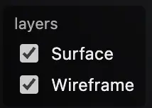
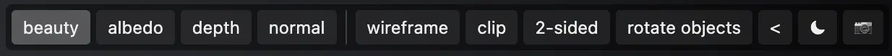

# Rendering and viewers

Hakowan provides two ways to create visualizations from a layer specification:

* `render(...)` generates a polished final rendering of a visualization. It is useful for producing
  paper figures, presentations, and interactive demonstrations.
* `observe(...)` provides fast and structured views of the visualization. It is designed for
  automatic inspection of visualizations by AI agents.

This section focuses on the `render` feature, and the [next section](observation.md) covers the `observe` feature.

## Simple use case

Here is a simple example of generating an interactive WebGL visualization from a layer:

```py
import hakowan as hkw

layer = hkw.layer("mesh.obj")  # Change to your mesh file path
result = hkw.render(layer)  # Backend-specific rendering
print(result.path)  # The output visualization file
```

## Backends

Hakowan supports three rendering backends: WebGL, Mitsuba, and Blender. WebGL is the default
backend that ships with the base install. Mitsuba and Blender are optional. They can be installed
with `pip install "hakowan[mitsuba]"` or `pip install "hakowan[blender]"`. To see which backends are
available:

```py
print(hkw.list_backends())  # installed, available backends
```

To change the default backend:

```py
hkw.set_default_backend("mitsuba")
```

In addition, the `hkw.render()` function also accepts an optional `backend` argument to override the default backend for a single call:

```py
hkw.render(layer, filename="output.exr", backend="mitsuba")
```

It is recommended to use WebGL for interactive visualization or demos because it is fast and easy to
share. Mitsuba is useful for generating polished visualizations for publication and presentations. Blender
is useful if you want to export the scene and fine-tune it in Blender.


### WebGL

Use WebGL for an interactive, shareable browser viewer. It requires only the base install and a
modern browser. By default, it supports a number of useful features for interactive visualization,
including different render passes, wireframe, clipping planes, and camera projection switching.

```py
hkw.render(layer, filename="viewer.html", backend="webgl")
```

When multiple views use identical vertex and index data, the WebGL exporter shares
those glTF accessors even when the views have different materials or per-vertex
colors. This reduces the embedded HTML/GLB payload without merging the views or
their independent attributes.

Use `background="transparent"` to reveal the embedding page behind the viewer and
preserve alpha in saved beauty-pass PNGs:

```py
hkw.render(layer, filename="viewer.html", backend="webgl", background="transparent")
```

The same setting is available through `Config.background`,
`figure.output(background="transparent")`, and `hkw.observe(..., background="transparent")`.
Transparent mode hides a camera-visible environment map but retains its lighting
and reflections. Albedo, depth, and normal passes keep their opaque diagnostic
backgrounds. `None` selects `"auto"`, following the system light/dark theme live.

Use `background="white"` for solid opaque white instead of the `"light"` studio
gradient. It is also supported by `Config.background`, Figure output settings,
observation snapshots, and raster output backgrounds.

#### Viewer controls

In the interactive viewer, use the left mouse button to rotate, the right mouse button to pan, and the mouse
wheel to zoom.

{: align="right" style="width:90px"}

A unique feature of the interactive viewer is that it allows users to toggle the visibility of each
layer. In the bottom-left corner of the viewer is a list of checkboxes labeled with the layer names.
Unnamed layers receive generated labels. Click a checkbox to toggle the corresponding layer's visibility.

{: style="width:500px"}

The top-right corner of the viewer contains a set of control buttons.

* "**beauty**", "**albedo**", "**depth**", "**normal**" buttons switch between different render passes.
* "**wireframe**" toggles wireframe overlay on/off.
* "**clip**" toggles the interactive clipping plane on/off. Once on, users can control the
clipping plane orientation and offset interactively.
* "**2-sided**" toggles backface culling on/off.
* "**rotate objects**" toggles the rotation center between object centroid and scene center. This
option is only relevant for juxtaposed views.
* "**<**"/"**=**" toggles between perspective and orthographic camera projection. The default is
perspective.
* Click the background button to choose auto (A), light (☀), dark (☾), black (⚫),
  white (⚪), or transparent (👻).
  Auto is the default and follows the browser's system theme.
* "**:camera:**" button saves a snapshot of the current view as a PNG image.


#### Embed a viewer

The interactive visualization can be embedded in another webpage:

```py
result = hkw.render(layer, filename="viewer.html", backend="webgl")
iframe = result.embed_html(src="visualizations/viewer.html", height=420)
```

Set `src` to the published viewer path, or omit it when the embedding page and
viewer share a directory. Adjust `title`, `width`, and `height` as needed.
The resulting `iframe` HTML snippet can be inserted into an HTML page.
Here is an example:

<iframe src="../../gallery-demos/Spot/results/spot_wireframe.html" title="Interactive 3D visualization Demo" width="800" height="300" loading="lazy" style="border:0;"></iframe>


#### Sharing

The interactive visualization is stored in a self-contained HTML file that is ready to share.
Just send the HTML file. Depending on the complexity of the scene, it may be large. To
reduce the size of the HTML file, the assets can be stored in a separate folder. Use
`offline=True` to generate a `viewer_assets/` folder containing GlTF assets alongside the HTML
file:

```py
hkw.render(layer, filename="viewer.html", backend="webgl", offline=True)
```


### Mitsuba

Use Mitsuba for photorealistic images with advanced materials and lighting,
including GPU-accelerated rendering where supported. Install the optional extra:

```sh
pip install "hakowan[mitsuba]"
```

```py
hkw.render(layer, filename="output.exr", backend="mitsuba")
# Also save the Mitsuba scene configuration.
hkw.render(layer, filename="output.exr", backend="mitsuba", yaml_file="scene.yaml")
```

The optional `yaml_file` argument saves the Mitsuba scene configuration in a YAML file. This is
useful for debugging Mitsuba or for re-rendering the scene with Mitsuba directly.


### Blender

Use Blender for Cycles or EEVEE images, editable `.blend` scenes, and albedo,
depth, normal, and facet-ID passes. The extra requires Python 3.13:

```sh
pip install "hakowan[blender]"
```

```py
hkw.render(layer, filename="output.png", backend="blender", blend_file="scene.blend")
# Select EEVEE instead of Cycles.
hkw.render(layer, filename="output.png", backend="blender", engine="BLENDER_EEVEE")
```

The optional `blend_file` argument saves the Blender scene in a `.blend` file. This is useful for
debugging Blender or for re-rendering the scene with Blender directly. The optional `engine`
argument selects the Blender rendering engine. The default is Cycles, but EEVEE can be selected
for faster rendering of simple scenes.

### Work with the result

Every backend returns a `RenderResult`:

```py
result.path  # main output path, or None if no filename was given
result.image  # in-memory image (Mitsuba, Blender); None for WebGL
result.outputs  # manifest: {"main": ..., "<pass>": <path or "interactive">}
result.backend  # backend that produced the result
```

`result.outputs` includes per-pass sidecars; see [render passes](config.md#render-passes).
When a main file was written, the result is path-like and can be passed to
`open()` or `pathlib.Path`. Use `result.image` for notebook display.
Full signatures are in the [render API reference](../api/render.md).


## Troubleshooting

`hkw.list_backends()` omits unavailable optional backends. If Mitsuba or Blender
is missing, install its extra in the Python environment running Hakowan and
check the requirements above. WebGL is part of the base install and is always
available. For Chromium installation or capture limitations, use the
[capture guide](observation.md).

### Inspect capabilities

Capability declarations can be queried without importing heavyweight backend
modules, including declarations for unavailable optional backends:

```py
caps = hkw.backend_capabilities("webgl")
print(caps.marks, caps.render_passes, caps.features, caps.limitations)
payload = caps.to_dict()  # JSON-safe
all_capabilities = hkw.list_backend_capabilities()
hkw.validate(layer, backend="webgl", strict=True)
```

Strict validation rejects requested behavior that the selected backend would
approximate or ignore. Use it before selecting a backend for an automated task.
